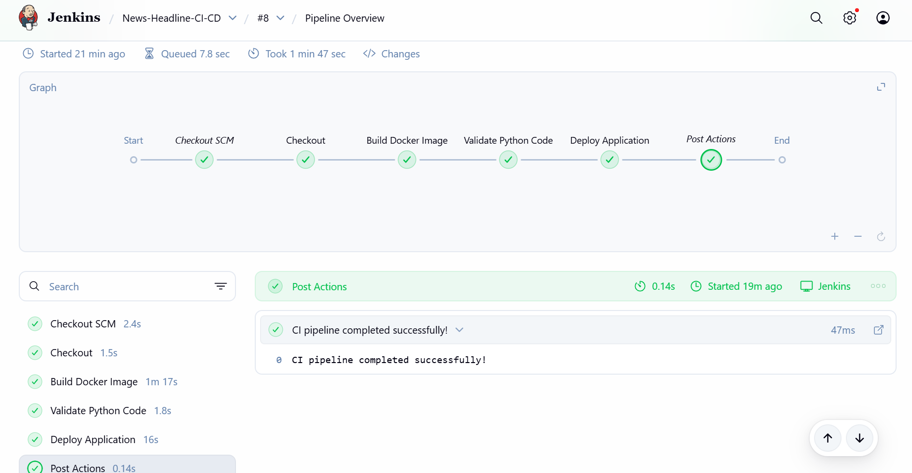
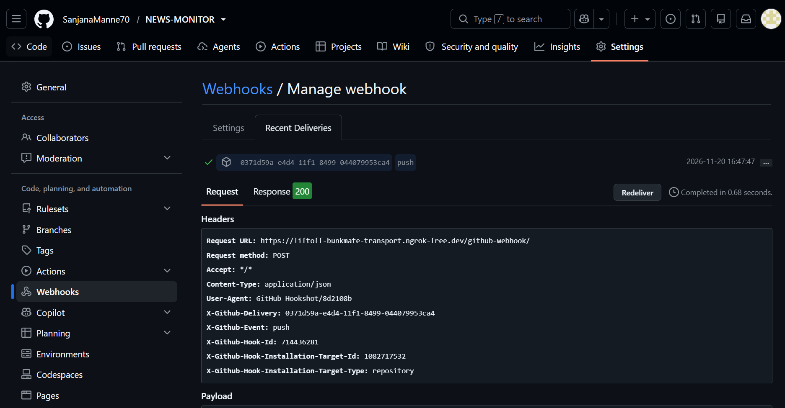
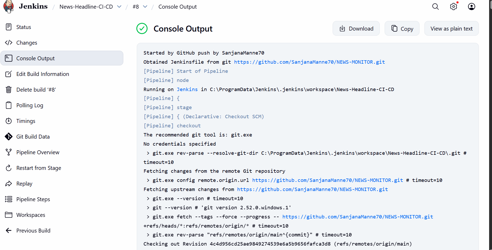
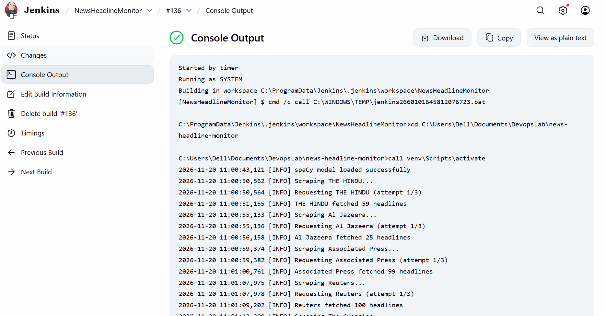
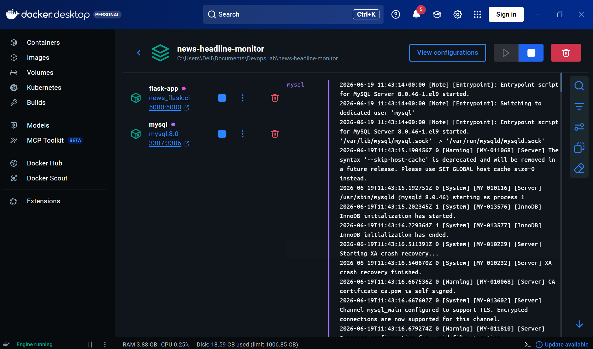

# 📰 News Headline Monitor

### Automated News Collection | NLP-Based Analysis | AI-Powered Query Assistant | CI/CD Automation

---
## 📌 Overview

**News Headline Monitor** is an automated news aggregation and analysis platform that collects headlines from multiple news sources, processes them using Natural Language Processing (NLP), and compares current headlines with historical records to identify new, unchanged, and updated stories.

The system combines web scraping, NLP techniques, historical data analysis, database management, and Generative AI to transform raw news headlines into structured and meaningful insights.

It also includes an **AI-Powered Query Assistant** that allows users to interact with stored news data using natural language instead of manually writing SQL queries.

The application uses Flask as the backend, MySQL for persistent storage, Docker for containerization, and Jenkins for automation. A Jenkins CI/CD pipeline integrated with GitHub automates application validation, Docker image creation, and deployment.

---

## 🎥 Project Demo

▶️ **[Watch the News Headline Monitor Demo](https://drive.google.com/file/d/1uzlSUMaRWeQCSZ-ZYIKPYc1TIsWHAj1E/view?usp=sharing)**

---
---

## 📸 Project Screenshots & DevOps Implementation

Explore the application interface and the automation infrastructure behind News Headline Monitor. Click any screenshot to view it in full size.

### 1. Jenkins CI/CD Pipeline

Automated pipeline execution covering source code checkout, Docker image building, Python validation, application deployment, and post-deployment actions.

<a href="docs/screenshots/jenkins-cicd-pipeline.png">
  
</a>

### 2. GitHub Webhook Integration

GitHub push events automatically notify Jenkins and trigger the CI/CD pipeline. The successful HTTP 200 response confirms webhook delivery.

<a href="docs/screenshots/github-webhook.png">
  
</a>

### 3. Automated Application Deployment

Jenkins deploys the updated Flask application through Docker Compose and verifies application availability using a post-deployment HTTP health check.

<a href="docs/screenshots/jenkins-deployment-success.png">
  
</a>

### 4. Scheduled News Scraping Automation

A separate Jenkins Freestyle job automatically executes the daily scraping process, collects headlines from configured news sources, and stores the results in MySQL.

<a href="docs/screenshots/jenkins-daily-scraper.png">
  
</a>

### 5. Docker Containerization

The application and database run as separate Docker containers, with dedicated services and port mappings.

<a href="docs/screenshots/docker-containers.png">
  
</a>

---

## ✨ Key Features

### 1. Automated News Collection

- Collects news headlines from multiple news outlets.
- Supports RSS feeds and HTML-based scraping.
- Uses Requests and BeautifulSoup for static content extraction.
- Includes Selenium-based scraping functionality for dynamic web pages.
- Retrieves up to 30 headlines per configured source during a scraping run.

### 2. Natural Language Processing

Each collected headline is processed using NLP techniques:

- **Sentiment Analysis:** Uses TextBlob to classify headlines as Positive, Negative, or Neutral.
- **Named Entity Recognition:** Uses spaCy to identify entities such as PERSON, ORG, GPE, EVENT, and PRODUCT.
- **News Categorization:** Uses rule-based keyword matching to classify headlines into:
  - Politics
  - Sports
  - Business
  - Technology
  - Health
  - World
  - Crime
  - Weather
  - Environment
  - General

### 3. Historical Headline Comparison

The system compares today's headlines with previously stored headlines, particularly those from the previous day, to identify changes in news coverage.

Headlines are classified into:

- 🟢 **New:** No sufficiently similar historical headline is found.
- 🟡 **Updated:** A similar headline exists, but the wording or content has changed.
- ⚪ **Unchanged:** An exact headline match is found.

#### Hybrid Similarity Algorithm

The system combines three comparison methods:

| Technique | Weight | Purpose |
|---|---:|---|
| Sequence Similarity | 25% | Measures textual similarity between headlines |
| Important Word Overlap | 50% | Measures overlap between meaningful words |
| Named Entity Overlap | 25% | Compares identified entities |

**Similarity Score:**

```text
Similarity Score =
    (0.25 × Sequence Similarity)
  + (0.50 × Word Overlap)
  + (0.25 × Entity Overlap)
```

A similarity threshold of **0.25** is used to identify potential historical matches.

Exact headline matches are classified as unchanged. Similar but non-identical matches are classified as updated. Headlines without a qualifying historical match are considered new.

The system also tracks previously matched historical records to avoid matching one historical headline with multiple current headlines.

### 4. Similar Story Grouping

- Identifies related headlines published by different sources on the same day.
- Uses SequenceMatcher to calculate textual similarity.
- Groups headlines when their similarity score exceeds 0.60.
- Helps identify how different news outlets cover similar stories.

### 5. AI-Powered Query Assistant

The platform includes a conversational AI assistant that allows users to ask questions about stored news data in natural language.

**Example queries:**

- Which news source published the highest number of negative headlines?
- Show me today's technology headlines.
- How many headlines were collected in the last seven days?
- Which entities appeared most frequently?
- Compare sentiment across different news sources.
- Show the latest headlines related to a particular organization.

#### How It Works

The Query Assistant follows a controlled architecture that separates AI-based interpretation from database execution.

1. **Natural Language Input:** The user enters a question through the dashboard.
2. **Intent Extraction:** Gemini interprets the question and extracts structured information such as operation, entity, source, sentiment, category, date range, and sorting preference.
3. **Intent Validation:** Python validates the extracted intent against predefined allowed operations and permitted filters.
4. **SQL Query Construction:** Python builds the SQL query using predefined query structures and parameterized values.
5. **Database Execution:** The query is executed against the MySQL database.
6. **Answer Generation:** Gemini receives the actual database results and converts them into a readable natural language response.

**Important Design Decision:** Gemini does not directly generate or execute SQL queries. Python validates the extracted intent and constructs parameterized SQL queries. This provides greater control over database operations and reduces the risk of unsafe query execution.

The assistant supports:

- Headline listing
- Headline counting
- Daily headline counts
- Sentiment breakdown
- Source-wise breakdown
- Top entity analysis

It also supports conversational follow-up questions using recent browser-provided conversation history. Conversation history is not persisted in the database.

### 6. Interactive Dashboard

The Flask application provides a dashboard to explore collected news data and analysis.

The backend exposes APIs for:

- Today's headlines
- Historical comparison
- Entity analysis
- Similar story groups
- Last scraping status
- AI-powered natural language queries
- Manual scraping trigger

### 7. Automated Daily Scraping with Jenkins

A standalone Python script, `run_daily.py`, is configured to run through a Jenkins Freestyle job.

The automation process:

1. Connects to the MySQL database.
2. Collects headlines from the configured news sources.
3. Performs NLP processing.
4. Identifies successfully scraped and failed sources.
5. Refreshes current-day records only for sources that were scraped successfully.
6. Preserves previously stored records for sources that failed.
7. Inserts the newly collected headlines.
8. Records the scraping execution status in the database.

The script distinguishes between:

- **Success:** All configured sources were scraped successfully.
- **Partial:** Some sources succeeded while others failed.
- **Failed:** All configured sources failed.

This source-level handling helps prevent temporary scraping failures from unnecessarily removing previously collected news records.

### 8. Automated CI/CD Pipeline with Jenkins and GitHub

The project includes a separate Jenkins Pipeline job integrated with GitHub to automate application integration and deployment.

Whenever code is pushed to the configured GitHub branch, GitHub sends a webhook notification to Jenkins, triggering the pipeline automatically.

#### CI/CD Pipeline Stages

| Stage | Description |
|---|---|
| Checkout | Retrieves the latest source code from GitHub |
| Docker Image Build | Builds the application Docker image |
| Python Code Validation | Performs Python syntax validation using `compileall` |
| Deployment | Deploys the updated Flask application using Docker Compose |
| Health Check | Verifies application availability through an HTTP request |

#### CI/CD Workflow

```text
             DEVELOPER
                 |
                 v
          CODE CHANGES
                 |
                 v
          GIT COMMIT & PUSH
                 |
                 v
             GITHUB
                 |
                 v
          GITHUB WEBHOOK
                 |
                 v
              JENKINS
                 |
                 v
         CHECKOUT LATEST CODE
                 |
                 v
         BUILD DOCKER IMAGE
                 |
                 v
        PYTHON SYNTAX VALIDATION
                 |
                 v
        DEPLOY FLASK APPLICATION
                 |
                 v
         APPLICATION HEALTH CHECK
                 |
                 v
          HTTP 200 OK
                 |
                 v
        UPDATED APPLICATION
```

#### Deployment Strategy

- Jenkins builds the application image using the repository's Dockerfile.
- Python syntax validation is performed inside the built Docker image.
- Jenkins uses a secured Jenkins Secret File credential to provide the application environment configuration during deployment.
- Docker Compose updates the Flask application service.
- The MySQL database service and its persistent volume are kept separate from the application deployment.
- A post-deployment HTTP health check verifies that the Flask dashboard is responding successfully.

**Important Design Decision:** The deployment targets only the Flask application service. The MySQL service and its named persistent volume are preserved, preventing application deployments from unnecessarily removing stored headline data.

#### GitHub Webhook Integration

GitHub is configured to send push-event notifications to Jenkins through the GitHub webhook endpoint.

The webhook integration enables:

- Automatic Jenkins pipeline triggering after a GitHub push.
- Removal of the need for manually starting each CI/CD build.
- Continuous integration of repository changes.
- Automated application deployment after successful pipeline execution.

The local Jenkins server is exposed to GitHub through an ngrok HTTPS tunnel for webhook communication during development.

**Note:** The ngrok tunnel is used for development-time connectivity. It is not a permanent cloud hosting solution.

---

## 🏗️ System Architecture

```text
                    NEWS SOURCES
                         |
                         v
               AUTOMATED NEWS SCRAPING
                Requests / BeautifulSoup
                      Selenium
                         |
                         v
                  NLP PROCESSING
              ---------------------
              | Sentiment Analysis |
              | Entity Recognition |
              | News Categorization|
              ---------------------
                         |
                         v
                   MYSQL DATABASE
              ---------------------
              |     Headlines     |
              |    Scrape Logs    |
              ---------------------
                    /         \
                   /           \
                  v             v
           FLASK WEB APP    JENKINS JOB
                  |             |
                  v             v
          INTERACTIVE       DAILY SCRAPING
           DASHBOARD          AUTOMATION
                  |
                  v
           AI QUERY ASSISTANT
                  |
                  v
         GEMINI INTENT EXTRACTION
                  |
                  v
         PYTHON INTENT VALIDATION
                  |
                  v
          PARAMETERIZED SQL
                  |
                  v
          MYSQL QUERY RESULTS
                  |
                  v
         GEMINI RESPONSE GENERATION
                  |
                  v
          NATURAL LANGUAGE ANSWER


          SEPARATE CI/CD WORKFLOW

              GITHUB REPOSITORY
                      |
                      v
               GITHUB WEBHOOK
                      |
                      v
                   JENKINS
                      |
                      v
              CHECKOUT SOURCE CODE
                      |
                      v
              BUILD DOCKER IMAGE
                      |
                      v
              PYTHON VALIDATION
                      |
                      v
              DEPLOY FLASK SERVICE
                      |
                      v
                HEALTH CHECK
```

---

## 🛠️ Technology Stack

| Component | Technologies |
|---|---|
| Backend | Python, Flask |
| Frontend | HTML, CSS, JavaScript, Bootstrap |
| Database | MySQL 8.0 |
| Web Scraping | Requests, BeautifulSoup, Selenium |
| NLP | spaCy, TextBlob |
| Similarity Analysis | SequenceMatcher, Word Overlap, Entity Overlap |
| Generative AI | Google Gemini API |
| Database Connectivity | MySQL Connector |
| Automation | Jenkins |
| CI/CD | Jenkins Pipeline, GitHub Webhooks |
| Containerization | Docker, Docker Compose |
| Production Server | Gunicorn |
| Environment Management | Python-dotenv |
| Webhook Tunneling | ngrok |

---

## 🐳 Docker Architecture

The application uses Docker Compose to manage the Flask backend and MySQL database.

### Services

| Service | Container | Purpose |
|---|---|---|
| Flask | `news_flask` | Runs the Flask application using Gunicorn |
| MySQL | `news_mysql` | Stores headlines and scraping logs |

### Docker Configuration

**Dockerfile**

- Uses Python 3.11 slim as the base image.
- Installs Python dependencies.
- Installs the spaCy English language model.
- Exposes port 5000.
- Uses Gunicorn to serve the Flask application.

**Docker Compose**

- Creates the Flask and MySQL services.
- Connects both services through the Docker Compose network.
- Uses a named volume to persist MySQL data.
- Maps host port 3307 to MySQL container port 3306.
- Maps host port 5000 to the Flask application.

### Application Architecture

```text
                 DOCKER COMPOSE
                       |
           +-----------+-----------+
           |                       |
           v                       v
     FLASK CONTAINER         MYSQL CONTAINER
       Port: 5000              Port: 3306
           |                       |
           +---- Docker Network ---+
                       |
                 Persistent Volume
                    mysql_data
```

Jenkins is configured separately and is not included as a Docker Compose service.

The daily scraper executes independently through the Jenkins Freestyle job. The CI/CD Pipeline job builds and deploys the Flask application.

---

## 📂 Project Structure

```text
news-headline-monitor/
│
├── app.py
│   └── Main Flask application, scraping logic,
│       NLP processing, comparison, and APIs
│
├── query_assistant.py
│   └── Gemini-powered natural language
│       Query Assistant
│
├── run_daily.py
│   └── Standalone daily scraping script
│       configured for Jenkins execution
│
├── templates/
│   └── index.html
│       └── Dashboard interface
│
├── docs/
│   └── screenshots/
│       ├── dashboard.png
│       ├── jenkins-pipeline.png
│       ├── deployment-health-check.png
│       ├── github-webhook.png
│       ├── docker-containers.png
│       └── daily-scraper-jenkins.png
│
├── requirements.txt
│   └── Python dependencies
│
├── Dockerfile
│   └── Flask application container configuration
│
├── docker-compose.yml
│   └── Flask and MySQL service configuration
│
├── Jenkinsfile
│   └── Declarative CI/CD pipeline definition
│
├── .env.example
│   └── Environment variable template
│
├── .gitignore
│
└── README.md
```

*The structure above illustrates the intended repository organization. Keep only files and folders that actually exist in your repository.*

---

## ⚙️ Setup and Installation

### Prerequisites

- Python 3.11
- Docker Desktop
- Docker Compose
- Jenkins (for automation and CI/CD)
- Git
- Google Gemini API key

### 1. Clone the Repository

```bash
git clone https://github.com/SanjanaManne70/NEWS-MONITOR.git

cd NEWS-MONITOR
```

### 2. Configure Environment Variables

Create a `.env` file in the project root.

Example:

```env
# MySQL Configuration for Flask inside Docker
MYSQL_ROOT_PASSWORD=your_mysql_password
MYSQL_DATABASE=news_monitor
MYSQL_USER=root
MYSQL_HOST=mysql
MYSQL_PORT=3306

# Gemini API
GEMINI_API_KEY=your_gemini_api_key

# Database Configuration for Jenkins running on host
DB_HOST=127.0.0.1
DB_PORT=3307
DB_USER=root
DB_PASSWORD=your_mysql_password
DB_NAME=news_monitor
```

**Note:** The Flask container connects to MySQL using the Docker service hostname `mysql` and container port `3306`. The standalone Jenkins scraper runs on the host and connects through `127.0.0.1:3307`.

Never commit your actual `.env` file or API keys to GitHub.

### 3. Build and Run Using Docker Compose

```bash
docker compose up --build -d
```

Check running containers:

```bash
docker ps
```

View application logs:

```bash
docker compose logs -f flask-app
```

View MySQL logs:

```bash
docker compose logs -f mysql
```

### 4. Access the Application

Open:

```text
http://localhost:5000
```

### 5. Stop the Containers

```bash
docker compose down
```

To remove containers and the associated named database volume:

```bash
docker compose down -v
```

**Warning:** The `-v` option deletes the persisted MySQL data. Use it only when you intentionally want to remove the database volume.

---

## 🔄 Jenkins Automation

The project uses two independent Jenkins jobs.

### 1. Daily Scraping Job — Freestyle Project

The daily scraping script is designed to execute independently through a scheduled Jenkins Freestyle job.

**Execution:**

```bash
python run_daily.py
```

The script connects to the MySQL database through the host-mapped port:

```text
127.0.0.1:3307
```

#### Automation Workflow

```text
          JENKINS SCHEDULE
                 |
                 v
            run_daily.py
                 |
                 v
           CONNECT TO MYSQL
                 |
                 v
          SCRAPE NEWS SOURCES
                 |
                 v
           NLP PROCESSING
                 |
                 v
        SOURCE-LEVEL STATUS CHECK
                 |
                 v
        REFRESH SUCCESSFUL SOURCES
                 |
                 v
          INSERT HEADLINES
                 |
                 v
          UPDATE SCRAPE LOGS
                 |
                 v
           EXECUTION STATUS
```

The standalone script includes retry handling for HTTP 429 responses, source-level success and failure tracking, and database transaction handling.

### 2. CI/CD Job — Jenkins Pipeline

The CI/CD workflow is implemented as a separate Jenkins Pipeline job named:

```text
News-Headline-CI-CD
```

It uses the `Jenkinsfile` stored in the GitHub repository.

#### Pipeline Configuration

- Pipeline type: Pipeline
- Definition: Pipeline script from SCM
- SCM: Git
- Repository: `https://github.com/SanjanaManne70/NEWS-MONITOR.git`
- Branch: `*/main`
- Script Path: `Jenkinsfile`
- Build Trigger: GitHub hook trigger for GITScm polling

#### Pipeline Implementation

The pipeline performs the following operations:

1. Checks out the latest repository code.
2. Builds the Docker image using the repository Dockerfile.
3. Validates Python syntax inside the Docker image.
4. Retrieves the application environment configuration through Jenkins credentials.
5. Deploys only the Flask service using Docker Compose.
6. Waits for the application to start.
7. Performs an HTTP health check against the dashboard.

The deployment uses a Jenkins Secret File credential to supply the `.env` configuration. The temporary `.env` file is removed after deployment.

#### Deployment Command

The Flask application is deployed using:

```bash
docker compose -p news-headline-monitor up -d --no-deps --no-build flask-app
```

This updates the application service without intentionally recreating the MySQL service.

#### Health Check

After deployment, Jenkins checks the dashboard endpoint:

```text
http://localhost:5000
```

A successful HTTP response of `200 OK` indicates that the Flask dashboard is responding.

#### GitHub Webhook

The GitHub repository is configured with a webhook that sends push-event notifications to Jenkins.

The webhook integration enables automatic pipeline triggering whenever code is pushed to the configured branch.

During development, ngrok provides an HTTPS tunnel to the locally running Jenkins server so GitHub can reach its webhook endpoint.

**Note:** The ngrok tunnel must be running and its URL must remain valid for webhook delivery. The current configuration is intended for development-time automation rather than permanent cloud hosting.

---

## 🗄️ Database Design

The application uses MySQL to maintain collected headlines and scraping execution history.

### 1. Headlines Table

| Column | Description |
|---|---|
| id | Unique headline identifier |
| source | News source |
| headline | Headline text |
| url | Original news URL |
| scraped_date | Date of collection |
| scraped_time | Time of collection |
| category | Assigned news category |
| sentiment | Sentiment polarity |
| sentiment_label | Positive, Negative, or Neutral |
| entities | Extracted named entities stored as JSON |
| created_at | Record creation timestamp |

A unique key on source, headline, and scraped date helps prevent duplicate records.

### 2. Scrape Logs Table

| Column | Description |
|---|---|
| id | Unique log identifier |
| scrape_datetime | Scraping execution timestamp |
| total_headlines | Total collected headlines |
| status | Success, Partial, or Failed |
| created_at | Record creation timestamp |

---

## 🔌 API Endpoints

| Endpoint | Method | Description |
|---|---|---|
| `/` | GET | Loads the dashboard |
| `/api/query` | POST | Processes natural language queries |
| `/api/scrape` | POST | Triggers a manual scraping operation |
| `/api/last-scrape` | GET | Retrieves the latest scraping status |
| `/api/headlines/today` | GET | Retrieves today's headlines |
| `/api/comparison` | GET | Retrieves historical headline comparison |
| `/api/entities` | GET | Retrieves frequently identified entities |
| `/api/similar-groups` | GET | Retrieves groups of similar headlines |

---

## 🔍 Important Implementation Details

### Historical Comparison

The comparison process combines textual similarity, important-word overlap, and named entity overlap to identify potentially related headlines.

### Query Assistant Security and Reliability

- Uses a predefined list of supported database operations.
- Validates structured intent before executing a query.
- Uses parameterized SQL values.
- Keeps SQL construction under Python application control.
- Uses actual database results when generating responses.
- Provides a Python fallback response if Gemini is unavailable.

### Scraping Reliability

- Uses retry handling for HTTP 429 responses in the standalone Jenkins scraper.
- Distinguishes failed scraping from a successful scrape that returns no headlines.
- Preserves existing records for sources that fail during the daily scraping process.
- Uses database transactions and rollback handling.

### CI/CD and Deployment Reliability

- Uses GitHub webhooks to trigger Jenkins builds automatically after pushes.
- Validates Python syntax before deployment.
- Uses Docker image builds to package the application.
- Uses Jenkins credentials to manage deployment environment configuration.
- Deploys the Flask service separately from the MySQL database.
- Uses a persistent MySQL volume to preserve stored data.
- Performs a post-deployment HTTP health check.

---

## 🚀 Future Enhancements

- Deploy the application to a cloud hosting platform.
- Introduce a permanent public dashboard URL.
- Add authentication and role-based access control.
- Add advanced analytics and interactive visualizations.
- Improve news categorization using machine learning.
- Introduce more robust duplicate and story detection.
- Add support for additional news sources.
- Improve scraping reliability and dynamic content handling.
- Add advanced application monitoring and logging.
- Introduce database migrations and improved database health checks.

---

## 🔐 Security Considerations

Before deploying the application publicly:

- Store API keys and database credentials in environment variables.
- Do not commit `.env` files.
- Avoid exposing the MySQL port publicly.
- Restrict access to the manual scraping endpoint.
- Add authentication and rate limiting to sensitive endpoints.
- Configure HTTPS.
- Disable Flask debug mode in production.
- Use a dedicated MySQL application user instead of root.
- Add database readiness checks before starting the Flask application.
- Secure Jenkins access and webhook configuration.
- Never expose Jenkins credentials, ngrok tokens, or secret files.

---

## 👩‍💻 Author

**Sanjana Manne**

B.Tech – Computer Science and Engineering  
Jawaharlal Nehru Technological University, Hyderabad

---

## ⭐ Acknowledgements

Built as a hands-on project exploring automated web scraping, Natural Language Processing, database-driven analytics, Generative AI integration, Docker containerization, Jenkins automation, and CI/CD practices.

If you find this project interesting, consider giving the repository a ⭐!
